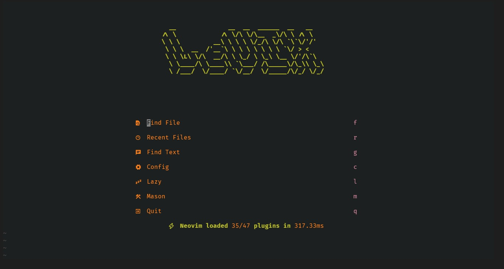

# LeVIX



> A handcrafted Neovim IDE built from scratch — every line written with purpose.


---

## Table of Contents

- [Architecture](#architecture)
- [Languages & Toolchains](#languages--toolchains)
- [Plugins](#plugins)
- [Commands](#commands)
- [Keybindings](#keybindings)
- [Project Scaffolding](#project-scaffolding--levixnewweb)
- [Install](#install)
- [Installer](#installer)
- [Dependencies](#dependencies)
- [Health Checks](#health-checks)
- [NixOS Users](#nixos-users)
- [License](#license)

---

## Architecture

### Entry Point (`init.lua`)

Loading order:

1. `core.options` — global Neovim options
2. `core.keymaps` — global keybindings
3. `config.lazy` — lazy.nvim bootstrap and plugin loading
4. `core.commands` — custom LeVIX commands and startup check

### Core Modules (`lua/core/`)

| File | Purpose |
|------|---------|
| `options.lua` | All vim.opt settings, leader key (Space), diagnostics config, transparent background, spell settings, folding disabled, theme cache restore |
| `keymaps.lua` | Single source of truth for all keymaps — organized by group with section headers. Covers: general, windows, buffers, find/search, git, code/LSP, terminal, file explorer, markdown preview, sessions, todos, theme switcher, zen mode. Keymaps that lazy-load a plugin with no other trigger (harpoon, debugger, live-server) live in the plugin's `keys` table with a real `rhs` — the lazy.nvim-canonical pattern |
| `commands.lua` | `:LeVIXUpdate`, `:LeVIXNewWeb`, `:LeVIXTransparency`, startup update check |
| `levix/health.lua` | `:checkhealth core.levix` implementation |
| `levix/newweb.lua` | `:LeVIXNewWeb` scaffolding logic |
| `levix/transparency.lua` | Background transparency — clears hl-group backgrounds (Normal, floats, chrome) so the host terminal (e.g. foot) shows through; re-applies on `ColorScheme`/`UIEnter` |

### Settings (`core/options.lua`)

- Leader key: Space
- Line numbers: `number` + `relativenumber`
- Clipboard: `unnamedplus` (syncs with system clipboard)
- Indentation: `tabstop=4`, `shiftwidth=4`, `expandtab`, `smartindent`
- Mouse: enabled
- Sign column: always visible
- Splits: right and below
- Termguicolors: enabled
- Undofile: enabled
- updatetime: 250ms
- timeoutlen: 300ms
- Scrolloff: 8
- Folding: disabled (`foldenable = false`)
- Background: opaque by default — `lua/core/levix/transparency.lua` can clear hl-group backgrounds (Normal, NormalFloat, NormalNC, SignColumn, LineNr, StatusLine, TabLine, FloatBorder, etc.) so the host terminal's transparency shows through (e.g. foot). Off by default; enable with `:LeVIXTransparency` (or set `vim.g.levix_transparency = true` for permanent on). Re-applied on `ColorScheme`/`UIEnter` when enabled. Pmenu/PmenuSel stay opaque for readability.
- Spell checking: enabled for markdown, text, and gitcommit (`lang: en_us`)
- Diagnostics: virtual text, signs, underline; severity-sorted; rounded float border with source
- Diagnostic signs: Nerd Font icons ( Error,  Warn,  Info,  Hint)
- Theme cache: reads `.levix_theme_cache` on startup to restore last-selected colorscheme

### Plugin Manager (`lua/config/lazy.lua`)

- lazy.nvim: bootstrapped from GitHub if not installed
- Auto-imports all plugin specs from `lua/plugins/` directory
- Default colorscheme for install phase: gruvbox
- Update checker enabled

---

## Languages & Toolchains

### Java

| Tool | Plugin |
|------|--------|
| LSP | jdtls (via `nvim-jdtls`) |
| Formatter | google-java-format (via `conform.nvim`) |
| Linter | checkstyle (via `nvim-lint`) |
| Debugger | jdtls DAP (via `nvim-jdtls`) |
| Mason packages | `jdtls`, `java-debug-adapter`, `google-java-format`, `stylua` (via `lsp.lua`) |

Java configuration lives in two files:
- `lua/plugins/lsp.lua` — standard LSP servers (does NOT include jdtls); also ensures `jdtls`, `java-debug-adapter`, `google-java-format`, `stylua` via Mason
- `lua/plugins/java-dap.lua` — configures nvim-jdtls: launches jdtls with project-specific workspace directory, attaches blink.cmp capabilities, sets up DAP with hot code replace

### Python

| Tool | Plugin |
|------|--------|
| LSP | pyright, ruff (both via `mason-lspconfig`) |
| Formatter | ruff_format (via `conform.nvim`) |
| Linter | ruff (via `nvim-lint`) |
| Debugger | nvim-dap-python (via `debugger.lua`) |

### C / C++

| Tool | Plugin |
|------|--------|
| LSP | clangd (via `mason-lspconfig`) |
| Formatter | clang-format (via `conform.nvim`) |
| Linter | clang-tidy (via `nvim-lint`, binary mapped via `executable_map = { clangtidy = "clang-tidy" }`) |
| Debugger | codelldb (via `mason-nvim-dap`) |

### Lua

| Tool | Plugin |
|------|--------|
| LSP | `lua_ls` (via `lazydev.nvim` for Neovim-specific annotations) |
| Formatter | stylua (via `conform.nvim`) |

### HTML

| Tool | Plugin |
|------|--------|
| LSP | html (vscode-html-language-server, via `mason-lspconfig`) |
| Formatter | prettier (via `conform.nvim`) |
| Linter | htmlhint (via `nvim-lint`) |

### CSS

| Tool | Plugin |
|------|--------|
| LSP | cssls (vscode-css-language-server, via `mason-lspconfig`) |
| Formatter | prettier (via `conform.nvim`) |
| Linter | stylelint (via `nvim-lint`) |

### JavaScript / TypeScript / JSX / TSX

| Tool | Plugin |
|------|--------|
| LSP | ts_ls (TypeScript language server, via `mason-lspconfig`) |
| Formatter | prettier (via `conform.nvim`) |
| Linter | eslint_d (via `nvim-lint`) |

---

## Plugins

### LSP Infrastructure

**`mason-org/mason.nvim`** — LSP/DAP/linter/formatter installer. Loaded via `:Mason` command. Rounded UI border. Custom icons for installed/pending/uninstalled.

**`mason-org/mason-lspconfig.nvim`** — Bridges Mason to lspconfig. Ensures these LSP servers are installed: pyright, clangd, ruff, html, cssls, ts_ls.

**`neovim/nvim-lspconfig`** — LSP configuration using Neovim 0.12+ native `vim.lsp.config()` and `vim.lsp.enable()`. Configures: pyright (basic type checking), ruff, clangd, html, cssls, ts_ls. Sets up `LspAttach` autocommand for buffer-local keymaps.

### Formatting

**`stevearc/conform.nvim`** — Format-on-save via `BufWritePre`. Checks formatter availability before running, shows one-time warning per formatter if missing. Falls back to LSP formatting.

### Linting

**`mfussenegger/nvim-lint`** — Lint-on-save via `BufWritePost` + `BufReadPost`. Checks executable availability before running, shows one-time warning per linter if missing. Uses `executable_map` for linters whose binary name differs (clangtidy → clang-tidy).

### Completion

**`saghen/blink.cmp`** — Autocompletion engine. Sources: lsp, path, snippets, buffer (spell only in markdown/text/gitcommit via `per_filetype`). Keymaps: Tab/S-Tab for navigation, Enter to accept, C-space to show/hide. Signature help enabled. No cargo build needed — release pins ship prebuilt fuzzy binaries (downloaded at runtime).

**`saghen/blink.lib`** — Native library dependency for blink.cmp.

**`L3MON4D3/LuaSnip`** — Snippet engine. Loads `friendly-snippets` from VS Code format via `lazy_load`.

**`ribru17/blink-cmp-spell`** — Spell-check completion source for blink.cmp.

### Debugging

**`mfussenegger/nvim-dap`** — Debug Adapter Protocol client. Configured adapters:
- codelldb (C/C++): server mode, port-based, executable from Mason install path; stops on entry
- nvim-dap-python (Python): dedicated venv with debugpy auto-bootstrapped into `~/.local/share/nvim/levix-dap-venv` on first F6 (system pip is PEP 668-locked); stops on entry
- bashdb (bash/sh): Mason's `bash-debug-adapter`, bashdb script from package dir
- Java via jdtls DAP (set up on LSP attach); stops on entry

All launch configs pause at the first line (`stopOnEntry = true`) so the DAP UI stays open — set breakpoints, then F6 to continue. Without this, trivial programs run to completion and the UI closes instantly.

DAP UI (`rcarriga/nvim-dap-ui`) opens automatically on debug start, closes on termination.

**`jay-babu/mason-nvim-dap.nvim`** — Ensures `codelldb` and `bash-debug-adapter` are installed via Mason.

**`mfussenegger/nvim-dap-python`** — Python DAP adapter.

**`mfussenegger/nvim-jdtls`** — Java DAP via jdtls. Sets up DAP with hot code replace. Per-project workspace directory.

### UI

**`nvim-lualine/lualine.nvim`** — Statusline. Sections: mode, branch/diff/diagnostics, filename, encoding/filetype, progress, location. Auto theme. Nerd Font icons.

**`akinsho/bufferline.nvim`** — Tabline. Shows LSP diagnostics. Close icons hidden.

**`stevearc/dressing.nvim`** — Replaces `vim.ui.select` and `vim.ui.input` with prettier UI. Lazy-loaded on first use via `init` hook.

**`folke/snacks.nvim`** — Dashboard with LeVIX ASCII logo. Key shortcuts: f=Find File, r=Recent Files, g=Find Text, c=Config, l=Lazy, m=Mason, q=Quit. Image support disabled. `lazy = false`, `priority = 1000`.

**`nvim-tree/nvim-web-devicons`** — Icon provider (used by oil.nvim, lualine.nvim, bufferline.nvim, aerial.nvim).

### Navigation & Search

**`nvim-telescope/telescope.nvim`** — Fuzzy finder. Commands: find_files (hidden files shown, ignores node_modules/.git), live_grep, buffers, help_tags, oldfiles, colorscheme. FZF native extension with `make` build step. Keymaps in `core/keymaps.lua`, lazy-loaded via `cmd = "Telescope"`.

**`ThePrimeagen/harpoon`** — File bookmarks. `harpoon2` branch. Quick jump via `<C-1>` through `<C-4>`. Keymaps defined in the plugin spec's `keys` table (with real `rhs`) — used as lazy-load trigger since the plugin has no other one.

### File Explorer

**`stevearc/oil.nvim`** — Edit filesystem as a buffer. Default file explorer. Shows hidden files. Icon column.

### Git

**`lewis6991/gitsigns.nvim`** — Git signs in sign column. Custom signs: ┃ add, ┃ change, _ delete, ‾ topdelete, ~ changedelete, ┆ untracked. Current line blame (500ms delay, EOL virtual text).

**Lazygit** — Integrated via toggleterm as a floating terminal. `_G.LeVIX.lazygit_toggle()` function. `<leader>gg` to toggle.

### Terminal

**`akinsho/toggleterm.nvim`** — Terminal manager. Default direction: float (rounded border). `<C-\>` mapping. Size: 20. Terminal mode keymaps: Esc to exit to normal mode, C-h/j/k/l for window navigation. Lazygit runs in a dedicated floating terminal instance.

### Sessions

**`rmagatti/auto-session`** — Session management. Lazy-loaded on `:AutoSession` command. Auto-save and auto-restore disabled (manual `<leader>ss`/`<leader>sr` workflow). Suppressed dirs: `~/`, `~/Downloads`, `/`.

### Theme Management

**`lua/plugins/themes.lua`** — Theme plugin declarations only. Available themes:
- catppuccin/nvim
- tokyonight.nvim
- gruvbox.nvim
- rose-pine/neovim
- kanagawa.nvim
- miasma.nvim
- darkvoid.nvim
- midnight.nvim
- monokai.nvim

`<leader>T` opens Telescope colorscheme picker (with preview disabled) or falls back to `vim.ui.select`. Selection is saved to `.levix_theme_cache` and restored on next startup via `core/options.lua`. Theme picker logic lives in `core/keymaps.lua`.

### Which-Key

**`folke/which-key.nvim`** — Keybinding popup. 500ms delay. Rounded border. Defines `<leader>` group labels: f=Find/Search, g=Git, c=Code/LSP, t=Terminal, d=Debug, T=Theme, a=Markdown, m=Todos, h=Harpoon, l=LiveServer, s=Sessions.

### Treesitter

**`nvim-treesitter/nvim-treesitter`** — Syntax highlighting and text objects. `lazy = false`. Parsers installed: java, python, c, cpp, lua, bash, markdown, markdown_inline. Auto-starts Treesitter on FileType. Sets `foldexpr` and `indentexpr`.

### Zen Mode

**`folke/zen-mode.nvim`** — Distraction-free writing. Width 0.99, hides signcolumn/numbers/cursorline. Disables gitsigns. Keeps tmux status line visible. Closes file tree and tagbar on open.

### Code Outline

**`stevearc/aerial.nvim`** — Code outline / tagbar. Right sidebar, width 35, shows guides.

### Emmet

**`mattn/emmet-vim`** — HTML/CSS/JS abbreviation expansion. `<C-y>,` in insert mode. Filetypes: html, css, javascript, javascriptreact, typescript, typescriptreact. Loads on InsertEnter.

### Utilities

**`windwp/nvim-autopairs`** — Auto-close brackets and quotes. Checks Treesitter for context-aware behavior (skips Lua strings and Java string_literals).

**`numToStr/Comment.nvim`** — Toggle comments with `gc` (operator) / `gcc` (line).

### Visual Enhancements

**`NvChad/nvim-colorizer.lua`** — Highlights color codes in files. Supports RGB, RRGGBB, RRGGBBAA, rgb()/hsl() CSS functions. Background highlight mode.

**`folke/noice.nvim`** — Replaces Neovim UI messages with a modern command-line interface. Uses `nvim-notify` for notifications. Bottom search, command palette, long messages to split.

**`rcarriga/nvim-notify`** — Notification backend for noice.nvim. 3s timeout, compact render, deduplicates. Sets `background_colour = "#000000"` — nvim-notify's 100%-transparency reference — required because `Normal` has no background highlight when transparency is enabled (avoids the "NotifyBackground has no background" warning, default would be the same color).

### Live Server

**`selimacerbas/live-server.nvim`** — Lightweight local development server with live-reload. Starts an HTTP server on a configurable port (default 8000), injects a live-reload script, and supports CSS injection without full page reload. Keymaps defined in the plugin spec's `keys` table (with real `rhs`) — used as lazy-load trigger since the plugin has no other one.

### Markdown Preview
**`selimacerbas/markdown-preview.nvim`** — Markdown preview in browser. Supports light and dark mode. Keymaps in `core/keymaps.lua`, lazy-loaded via `ft = "markdown"` and `cmd` triggers.

### Lua Development

**`folke/lazydev.nvim`** — Provides Neovim Lua API type annotations and completion for `vim.*`, `require()`, etc. Filetype-restricted to Lua buffers.

---

## Commands

### `:LeVIXUpdate`

Runs three operations sequentially:

1. `lazy.sync({ wait = true })` — updates all lazy.nvim plugins
2. `nvim-treesitter.install.update({ with_sync = true })` — updates Treesitter parsers
3. `git pull origin main` — pulls latest LeVIX core from GitHub

### `:LeVIXNewWeb <project-name>`

Creates a frontend project scaffold. Implementation in `lua/core/levix/newweb.lua`. Steps:

1. Creates `<project-name>/` directory in current working directory
2. Copies template files from `templates/frontend/` in the LeVIX config directory:
   - Starter files: `index.html`, `style.css`, `script.js`
   - Config files: `package.json`, `.prettierrc.json`, `.eslintrc.json`, `.stylelintrc.json`, `.gitignore`
3. Validates all JSON files with `vim.fn.json_decode`
4. Validates `index.html` contains a `<!DOCTYPE>` declaration
5. Checks if `stylelint-config-standard` is installed globally (npm), warns if missing
6. Switches Neovim cwd to the new project
7. Opens Oil file explorer at the project directory
8. Prints a summary with available LeVIX features (Emmet, format, lint, LSP)

The repo's `templates/` directory is structured for future expansion:

```
templates/
├── frontend/       # Current — HTML/CSS/JS starter projects
├── backend/        # Placeholder for future backend templates
└── systems/        # Placeholder for future systems templates
```

Template contents for `templates/frontend/`:

**`index.html`** — HTML5 template with `<!DOCTYPE html>`, linked style.css and script.js, empty `<title>`.

**`style.css`** — Empty.

**`script.js`** — Empty.

**`package.json`** — Declares devDependencies: typescript, eslint, prettier, stylelint, stylelint-config-standard (all `"latest"`).

**`.prettierrc.json`** — semi=true, trailingComma=es5, singleQuote=false, printWidth=100, tabWidth=2, useTabs=false, arrowParens=always, endOfLine=lf.

**`.eslintrc.json`** — env: browser/es2021/node, extends eslint:recommended, ecmaVersion latest, sourceType module, rules: indent=2, linebreak-style=unix, quotes=double, semi=always, no-unused-vars=warn.

**`.stylelintrc.json`** — extends stylelint-config-standard.

**`.gitignore`** — node_modules/, .DS_Store, dist/, build/, *.log, .env, .env.local, .vscode/, .idea/.

### `:LeVIXTransparency`

Toggles the transparent background (implemented in `lua/core/levix/transparency.lua`).

- Bare `:LeVIXTransparency` toggles; `:LeVIXTransparency on|off` forces a state.
- Clears backgrounds on ~18 highlight groups (`Normal`, `NormalFloat`, `NormalNC`, `NonText`, `SignColumn`, `LineNr`, `CursorLineNr`, `StatusLine`, `WinBar`, `TabLine`, `FloatBorder`, ...). Pmenu/PmenuSel stay opaque for readability.
- Re-applied automatically on `ColorScheme` (theme switches) and `UIEnter` — themes reset highlight groups on load, so a one-time `highlight Normal guibg=none` gets wiped the moment you switch themes.
- Disable permanently with `vim.g.levix_transparency = false`.
- Pairs with a transparent terminal: foot (`[colors] alpha`), or OpenCode's `matrix-transparent` custom theme, for a fully see-through setup.

### Startup Update Check

2 seconds after startup, LeVIX runs `git fetch origin main` in the config directory. If the local branch is behind, a notification is shown: `"✨ New updates available for LeVIX! Run :LeVIXUpdate to pull changes."` Disable with `vim.g.levix_check_updates = false`.

---

## C++ Build Module

A dedicated C++ workflow (first slice of C++ Overkill Mode) in `lua/core/levix/cpp/`. Detects CMake vs single-file projects, builds asynchronously, and runs/debugs the binary produced by the **same** build operation — a failed build can never run a stale executable, and a picked artifact older than a build that actually linked is flagged.

### Files

| File | Responsibility |
|---|---|
| `project.lua` | Detects project root, CMake vs single-file, current source |
| `build.lua` | Async builds (argv tables, no shell strings), quickfix parsing, executable discovery, safe clean |
| `debug.lua` | codelldb launch against the built binary (no manual path prompt) |
| `clangd.lua` | System-first clangd resolution, `--background-index`, `--compile-commands-dir`, `--query-driver` |
| `init.lua` | `:LeVIXCpp*` commands + buffer-local keymaps |

### `:LeVIXCpp*` commands

| Command | Behavior |
|---|---|
| `:LeVIXCppConfigure` | Configure CMake (`-S <root> -B <root>/build -DCMAKE_EXPORT_COMPILE_COMMANDS=ON`, Ninja when installed, `CMAKE_BUILD_TYPE=Debug` only on fresh caches) |
| `:LeVIXCppBuild` | Build current project (auto-configures when the cache or `compile_commands.json` is missing; refuses overlapping builds) |
| `:LeVIXCppRun` | Build, then run — single-file in `~/.cache/nvim/levix/cpp/<hash>/`, CMake from `<build>/`; output in the shared LeVIX float (ENTER closes) |
| `:LeVIXCppDebug` | Build, then debug the produced binary with codelldb (stops on entry) |
| `:LeVIXCppClean` | Clean `<root>/build` (requires `CMakeLists.txt`, refuses `/` and `$HOME`, needs UI confirmation) or the single-file cache dir |

Keymaps (buffer-local, C/C++ buffers): `<leader>bc` configure, `<leader>bb` build, `<leader>br` build & run, `<leader>bd` build & debug, `<leader>bx` clean.

### Single-file mode

`g++`/`clang++`/`c++` auto-detected; flags `-g -Wall -Wextra -std=c++20`; binaries go to a hashed cache dir, never next to the source. `.c` files use a C driver (`gcc`/`clang`/`cc`) with `-std=c17`, headers are not buildable. Args are always passed as argv lists — paths with spaces are safe.

### CMake mode

`CMakeLists.txt` detected by walking upward; dedicated `<root>/build` dir preserved across builds (generator/build type never overridden once a cache exists). After a build the module walks the build tree (depth ≤ 3) for executables — a single match is used directly, multiple matches open a `vim.ui.select` picker instead of guessing. Libraries (`*.so*`, `*.a`, `*.o`), `CMakeFiles/`, `_deps/` and `Testing/` are ignored; candidates are sorted newest first.

### Errors & navigation

Build output appears in a floating window (quickfix list populated from `file:line[:col]: severity: message`, relative paths resolved against the build cwd and the list cleared on success); build failures are notified distinctly from execution failures. Compiler output is preserved in the float on failure; suppressed on success when chained from run/debug.

### Tests

`nvim --headless -u tests/minimal_init.lua -l tests/cpp/test_cpp.lua` — 32 headless checks (detection incl. headers and case-insensitive extensions, paths with spaces, C/C++ command construction, spawn failures without tracebacks, failed build never reaching the run path, real build+run binary identity, staleness, quickfix, ambiguous executables and library filtering, clean safety incl. refusal paths, clangd args, real CMake configure/build integration). Tool-dependent cases report `skip` with a reason when a binary is absent; temp dirs only, never user projects.

---

## Keybindings

### Global Keymaps (`lua/core/keymaps.lua`)

All keymaps are defined in a single file organized by group. Plugin files only handle setup and lazy-load triggers.

| Key | Action | Description |
|-----|--------|-------------|
| `<leader>w` | `:write` | Save file |
| `<leader>q` | `:quit` | Quit |
| `<leader>R` | `:restart` | Restart Neovim |
| `<leader>v` | `:enew` | New buffer |
| `<C-h>` | `<C-w>h` | Move to left split |
| `<C-l>` | `<C-w>l` | Move to right split |
| `<C-j>` | `<C-w>j` | Move to bottom split |
| `<C-k>` | `<C-w>k` | Move to top split |
| `<C-Up>` | `:resize -2` | Decrease window height |
| `<C-Down>` | `:resize +2` | Increase window height |
| `<C-Left>` | `:vertical resize -2` | Decrease window width |
| `<C-Right>` | `:vertical resize +2` | Increase window width |
| `J` (visual) | `:m '>+1<CR>gv=gv` | Move selected line down |
| `K` (visual) | `:m '<-2<CR>gv=gv` | Move selected line up |
| `p` (visual) | `"_dP` | Paste without yanking |
| `<S-l>` | `:bnext` | Next buffer |
| `<S-h>` | `:bprevious` | Previous buffer |
| `<leader>x` | `:bdelete` | Close current buffer |
| `<Esc>` | `:nohlsearch` | Clear search highlight (defined in `core/options.lua`) |

### Terminal Keymaps

| Key | Context | Description |
|-----|---------|-------------|
| `<C-\>` | Global | Toggle terminal |
| `<leader>th` | Normal | Terminal horizontal |
| `<leader>tv` | Normal | Terminal vertical (size 60) |
| `<leader>tf` | Normal | Terminal float |
| `<leader>gg` | Normal | Toggle Lazygit (floating) |
| `<Esc>` | Terminal | Exit to normal mode |
| `<C-h>` | Terminal | Move to left window |
| `<C-j>` | Terminal | Move to bottom window |
| `<C-k>` | Terminal | Move to top window |
| `<C-l>` | Terminal | Move to right window |

### LSP Keymaps (set per-buffer via `LspAttach`)

| Key | Action | Description |
|-----|--------|-------------|
| `gd` | `vim.lsp.buf.definition` | Go to definition |
| `gr` | `vim.lsp.buf.references` | Go to references |
| `K` | `vim.lsp.buf.hover` | Hover documentation |
| `<leader>cr` | `vim.lsp.buf.rename` | Rename symbol |
| `<leader>ca` | `vim.lsp.buf.code_action` | Code action |
| `[d` | `vim.diagnostic.jump({ count = -1, float = true })` | Previous diagnostic |
| `]d` | `vim.diagnostic.jump({ count = 1, float = true })` | Next diagnostic |

### Find / Search (Telescope)

| Key | Description |
|-----|-------------|
| `<leader>ff` | Find files (includes hidden, excludes node_modules/.git) |
| `<leader>fs` | Live grep (search text) |
| `<leader>fb` | Find buffers |
| `<leader>fh` | Find help tags |
| `<leader>fo` | Recent files (oldfiles) |

### Git

| Key | Description |
|-----|-------------|
| `]g` | Next git hunk |
| `[g` | Previous git hunk |
| `<leader>gl` | Blame line |
| `<leader>gp` | Preview hunk diff |
| `<leader>gr` | Reset hunk |

### Code / LSP

| Key | Description |
|-----|-------------|
| `<leader>cf` | Format file (conform.nvim) |
| `<leader>cl` | Lint file (nvim-lint) |
| `<leader>co` | Toggle code outline (aerial.nvim) |

### Run & Debug

| Key | Description |
|-----|-------------|
| `<F5>` / `<leader>dr` | Run file (`core/levix/runner.lua`): runs python and bash, runs java single-file, compiles + runs c/cpp. Output opens in a floating terminal; when the program exits it shows "Press ENTER to close" — Enter closes the float |
| `<F6>` / `<leader>dc` | Run with debug (DAP continue — pick adapter, hit breakpoints, step with F10/F11/F12) |
| `<F10>` | Step over |
| `<F11>` | Step into |
| `<F12>` | Step out |
| `<leader>db` | Toggle breakpoint |
| `<leader>du` | Toggle debug UI |

### C++ Build (buffer-local, `lua/core/levix/cpp/init.lua`)

| Key | Description |
|-----|-------------|
| `<leader>bc` | Configure CMake |
| `<leader>bb` | Build project |
| `<leader>br` | Build & run |
| `<leader>bd` | Build & debug |
| `<leader>bx` | Clean build artifacts |

### Live Server (defined in `lua/plugins/live-server.lua`)

| Key | Description |
|-----|-------------|
| `<leader>lA` | Stop all |
| `<leader>li` | Show server status |
| `<leader>lo` | Open existing port in browser |
| `<leader>lr` | Force reload (pick port) |
| `<leader>ls` | Start (pick path & port) |
| `<leader>lS` | Stop one (pick port) |
| `<leader>lt` | Toggle live-reload (pick port) |

### Markdown Preview

| Key | Description |
|-----|-------------|
| `<leader>as` | Start preview |
| `<leader>ap` | Stop Preview |
| `<leader>ar` | Refresh preview |

### Harpoon (defined in `lua/plugins/harpoon.lua`)

| Key | Description |
|-----|-------------|
| `<leader>ha` | Add file to harpoon list |
| `<leader>hh` | Show harpoon menu |
| `<C-1>` | Go to file 1 |
| `<C-2>` | Go to file 2 |
| `<C-3>` | Go to file 3 |
| `<C-4>` | Go to file 4 |

### Sessions

| Key | Description |
|-----|-------------|
| `<leader>ss` | Save session |
| `<leader>sr` | Restore session |

### Todos

| Key | Description |
|-----|-------------|
| `<leader>mt` | Search project todos (Telescope) |
| `<leader>ml` | List local todos (quickfix list) |

### Theme

| Key | Description |
|-----|-------------|
| `<leader>T` | Switch theme (Telescope picker or vim.ui.select) |

### Navigation

| Key | Description |
|-----|-------------|
| `<leader>o` | Open Oil file explorer |
| `<leader>z` | Toggle zen mode |

### Emmet (Insert Mode)

| Key | Description |
|-----|-------------|
| `<C-y>,` | Expand Emmet abbreviation |

### Which-Key Group Labels

| Prefix | Group Name |
|--------|------------|
| `<leader>f` | Find/Search |
| `<leader>g` | Git Engine |
| `<leader>c` | Code/LSP |
| `<leader>t` | Terminal Management |
| `<leader>d` | Debug |
| `<leader>T` | Theme Switcher |
| `<leader>a` | Markdown Preview |
| `<leader>m` | Todo Tags |
| `<leader>h` | Harpoon Jump |
| `<leader>l` | LiveServer |
| `<leader>s` | Sessions Management |


---

## Install

Install the required tools with your package manager first:

```bash
# Arch
sudo pacman -S neovim git make unzip curl ripgrep fd nodejs python cargo
# Debian / Ubuntu
sudo apt install neovim git make unzip curl ripgrep fd-find nodejs python3 cargo
# Fedora
sudo dnf install neovim git make unzip curl ripgrep fd-find nodejs python3 cargo
# Void
sudo xbps-install neovim git make unzip curl ripgrep fd nodejs python3 cargo
# Gentoo
sudo emerge --ask dev-vcs/git sys-devel/make app-arch/unzip net-misc/curl sys-apps/ripgrep sys-apps/fd net-libs/nodejs dev-lang/python dev-lang/rust
# Nix
nix-env -iA nixpkgs.neovim nixpkgs.git nixpkgs.make nixpkgs.unzip nixpkgs.curl nixpkgs.ripgrep nixpkgs.fd nixpkgs.nodejs nixpkgs.python3 nixpkgs.cargo
```

Then clone and run the installer:

```bash
git clone https://github.com/Ledev0/LeVIX.git
cd LeVIX
bash install.sh
```

One-line curl (after reviewing the script):

```bash
curl -sSL https://raw.githubusercontent.com/Ledev0/LeVIX/main/install.sh | bash
```

Reopen your terminal so PATH changes take effect, then run `nvim +checkhealth core.levix`.

---

## Installer

`install.sh` (Linux/macOS) is the standalone installer that handles fresh installation and upgrades.

If the distro is already installed (`~/.config/nvim/.git`), the script runs:
1. `git pull origin main`
2. `nvim --headless "+Lazy! sync" +qa`

Then exits without reinstalling — upgrade mode.

### Linux / macOS (`install.sh`)

### Fresh Install Mode

The script does **not** install packages or detect your distro. It checks dependencies, offers an optional AppImage download for Neovim, prompts for language tooling, then clones the config.

**Step 1 — Neovim check**

If `nvim` is not in PATH or is older than 0.12, you are prompted:

```
Download Neovim AppImage instead? [y/N]
```

If you answer `y`, the script downloads the latest stable AppImage from GitHub and installs it to `/usr/local/bin/nvim`. It detects `doas` or `sudo` (in that priority) to escalate privileges when needed. If neither is available, it prints instructions to move the file manually.

**Step 2 — Core dependency check**

Verifies `git`, `make`, `unzip`, `curl`, `rg`, `fd`, `node`, `python3`, and `cargo` are in your PATH. If any are missing, it prints example install commands for each distro and exits:

```
Arch:   sudo pacman -S neovim git make unzip curl ripgrep fd nodejs python cargo
Debian: sudo apt install neovim git make unzip curl ripgrep fd-find nodejs python3 cargo
Fedora: sudo dnf install neovim git make unzip curl ripgrep fd-find nodejs python3 cargo
Void:   sudo xbps-install neovim git make unzip curl ripgrep fd nodejs python3 cargo
Gentoo: sudo emerge --ask dev-vcs/git sys-devel/make app-arch/unzip net-misc/curl sys-apps/ripgrep sys-apps/fd net-libs/nodejs dev-lang/python dev-lang/rust
Nix:    nix-env -iA nixpkgs.neovim nixpkgs.git nixpkgs.make nixpkgs.unzip nixpkgs.curl nixpkgs.ripgrep nixpkgs.fd nixpkgs.nodejs nixpkgs.python3 nixpkgs.cargo
```

**Step 3 — Language tooling (optional)**

You are prompted to install tooling for each language interactively. Selecting a language prints install suggestions; nothing is installed automatically.

| Language | Tool Check | Suggested Install |
|----------|------------|-------------------|
| Java | `java` (JDK >= 17) | Arch: `sudo pacman -S jdk-openjdk` · Debian: `sudo apt install openjdk-21-jdk` · Fedora: `sudo dnf install java-21-openjdk java-21-openjdk-devel` · Void: `sudo xbps-install openjdk21` · Gentoo: `sudo emerge --ask dev-java/openjdk:17` |
| Python | `ruff` | `pip install --user ruff` |
| C/C++ | `clang-tidy` | Arch: `sudo pacman -S clang` · Debian: `sudo apt install clang-tidy clang-format` · Fedora: `sudo dnf install clang-tools-extra` · Void: `sudo xbps-install clang-tools-extra` · Gentoo: `sudo emerge --ask sys-devel/clang` |
| Web Dev | `prettier`, `htmlhint`, `stylelint`, `eslint_d` | `npm install -g prettier htmlhint stylelint eslint_d` |

jdtls, checkstyle, google-java-format, and LSP servers (html, cssls, ts_ls) install automatically via Mason on first launch.

**Step 4 — Config backup & clone**

Existing `~/.config/nvim` is moved to `~/.config/nvim.bak.<timestamp>`. Then the LeVIX config is cloned from GitHub.

---

## Dependencies

### Required System Tools

| Tool | Purpose |
|------|---------|
| Neovim >= 0.12 | Core editor |
| git | lazy.nvim plugin manager, LeVIX updates |
| ripgrep (rg) | Telescope live grep |
| fd (fd-find on Debian/Fedora/Void, fd on Arch/Gentoo) | Telescope file finding |
| curl | mason.nvim downloads |
| make | Treesitter parser compilation |
| cargo | blink.cmp native fuzzy matcher build |
| Nerd Font | UI icons (statusline, bufferline, signs, dashboard) |
| unzip | Mason downloads |

### Per-Language Runtime Dependencies

| Language | Runtime | Tools |
|----------|---------|-------|
| Java | JDK >= 17 | jdtls, checkstyle, google-java-format (via Mason) |
| Python | Python 3 | ruff |
| C/C++ | gcc/g++ | clang-tidy, clang-format (via system package), codelldb (via Mason) |
| JavaScript/TypeScript | Node.js / npm | prettier, htmlhint, stylelint, eslint_d (`npm install -g`) |
| Lua | | stylua (via Mason) |
| HTML | | prettier, htmlhint |
| CSS | | prettier, stylelint |

---

## Health Checks

Run `:checkhealth core.levix` (implemented in `lua/core/levix/health.lua`).

Checks five categories:

### Core Tools
- git, rg, fd, curl

### Language Tooling
- java (JDK >= 17), python3, ruff, gcc, g++, clang-tidy

### Web Development Tools
- prettier, htmlhint, stylelint, eslint_d

### Build Requirements
- cargo (blink.cmp), make (Treesitter)

### Runtime
- Neovim version >= 0.12

---

## NixOS Users

LeVIX works on NixOS, but Mason-installed binaries (LSP servers, debuggers, formatters) require `nix-ld` to function because they are dynamically linked against FHS paths that do not exist on NixOS by default.

### Required Configuration

Add to your `configuration.nix`:

```nix
{
  programs.nix-ld.enable = true;
}
```

After applying (`sudo nixos-rebuild switch`), restart your shell and launch Neovim. Mason-installed binaries (jdtls, codelldb, pyright, clangd, etc.) will then resolve their shared library dependencies.

### Troubleshooting Mason Binaries

If a Mason-installed tool fails with "cannot execute" or "no such file or directory":

1. Find the binary path (e.g., `~/.local/share/nvim/mason/bin/jdtls`)
2. Run `ldd <path>` to identify missing shared libraries
3. Use `nix-locate <library>.so` to find which Nix package provides the missing library
4. Add the required packages to `environment.systemPackages` or use `nix-ld.libraries`

---

## License

MIT — see LICENSE file.

Built with fire by Seif Amr (Ledev0)
